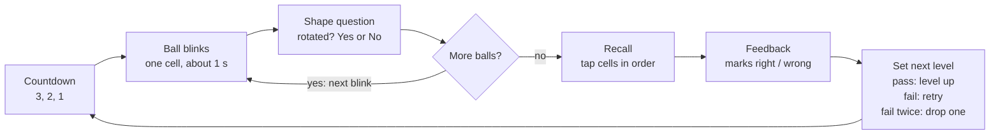
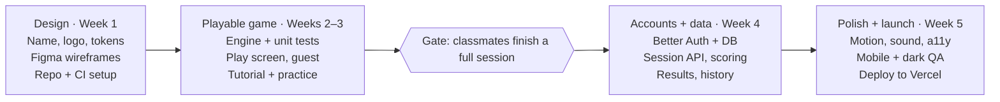

# Cognitive Games Platform — Product & Technical Plan

Nov 3, 2026 · Shubham Thakur

## Overview

Build a web app where students practise the cognitive games used in campus hiring tests, starting with one polished game: **Grid Recall**, modelled on Capgemini's Grid Challenge. Everything else (auth, history, more company games) is built around a game-agnostic core so new games plug in without touching the platform.

**Working name:** CogniArena (alternatives: PrepArcade, NeuroDrill). Check domain and app-store availability before committing. Describe the games as "inspired by game-based assessments used by companies like Capgemini" and never use a company's logo or claim affiliation.

**Who it's for:** final-year students preparing for placement drives, on laptop first and phone second.

**MVP scope (v1)**

- Landing page, logo, light and dark themes
- Sign in with Google or email, plus guest play
- Grid Recall with an interactive tutorial, practice round, levels and a configurable grid (rows × columns)
- Results screen and personal history

**Later:** more company games (Switch, Digit, Motion, Geo-Sudo), leaderboards, company-wise mock tests, a mobile app.

## Game design: Grid Recall

The player remembers the order in which balls blink on a grid while answering a quick shape question between every blink, then taps the cells back in order. It trains working memory under interruption, which is exactly what the real test measures.

**What the real test does.** Capgemini's game round uses Aon's game-based assessments; candidates get 4 games from a pool, and the Grid Challenge asks you to remember dot positions while solving symmetry or rotation tasks between displays ([JobsNet](https://jobsnet.in/capgemini-campus-recruitment-2020-interview-questions/)). Each cleared level gets harder, and the round is timed at about 6 minutes ([PrepInsta](https://prepinsta.com/capgemini-game-based-aptitude-test/)). Some candidates report a 9-minute version ([GeeksforGeeks](https://www.geeksforgeeks.org/?p=618162)), so make the session length a setting.

### One level, step by step

1. **Get ready** — 3-2-1 countdown, empty grid shown.
2. **Blink** — one cell lights up with a ball for about 1 second.
3. **Distractor** — the grid hides; a shape question appears (see below). The player answers Yes or No within a few seconds, or it times out.
4. Steps 2–3 repeat until every ball in the sequence has blinked.
5. **Recall** — empty grid returns. The player taps cells in the order they blinked. Each tap shows a number badge; Undo and Clear are available; Submit ends the level.
6. **Feedback** — correct cells turn green, wrong ones red, the true order is replayed briefly, then the next level (or a retry) starts.



The inner loop (blink, then question) repeats once per ball; the outer loop repeats once per level until the timer ends. If the session timer runs out at any point, the level stops and the Results screen opens.

### Distractor tasks

- **Rotation (v1, what you described).** Left: a thick polyomino shape such as an L-bar. Right: the same shape rotated by 90°, 180° or 270°, *or* a mirrored copy rotated. Question: "Is the right shape the left one, just rotated?" Yes = rotation only, No = mirrored.
- **Symmetry (v1.1).** A small pattern grid; question: "Is this pattern symmetric about the vertical line?" Matches the variant other candidates report.
- **Generator rule:** only use *chiral* shapes (shapes that differ from their mirror image). A symmetric L-bar would make "No" impossible and the question meaningless.
- Keep the answer split near 50/50 per level so guessing scores about half.

### Levels and difficulty

Pass a level when the whole sequence is recalled in the right order **and** at least 70% of distractors are correct. Pass → next level. Fail → retry the same level; fail twice → drop one level. The session ends when the timer runs out.

| Level | Grid | Balls | Blink (ms) | Distractor time (s) | Shape difficulty |
| --- | --- | --- | --- | --- | --- |
| 1 | 4×4 | 3 | 1000 | 5 | 4-cell L, 90° steps |
| 2 | 4×4 | 4 | 1000 | 5 | 4-cell L, 90° steps |
| 3 | 4×4 | 5 | 900 | 4.5 | 5-cell shapes |
| 4 | 5×5 | 6 | 900 | 4 | 5-cell, any of 3 angles |
| 5 | 5×5 | 7 | 800 | 4 | 6-cell, near-symmetric |
| 6 | 6×6 | 8 | 800 | 3.5 | 6-cell, near-symmetric |
| 7 | 6×6 | 9 | 700 | 3 | 7-cell, any of 3 angles (90° steps; 45° dropped because a 45° turn takes a polyomino off the grid) |
| 8+ | 6×6 | 10 (max) | 700 | 3 | 7-cell, any of 3 angles |

Every level adds exactly one ball, from 3 up to a maximum of 10 (changed after the owner's review: the real test grows by one ball per level). Changing the table bumps the game `version` (now 2).

These numbers are a starting point; tune them after play-testing with 5–10 classmates.

**Custom grid.** In Practice mode the player sets rows and columns (3–8 each, sliders). The grid then stays fixed and only balls, timings and shape difficulty climb with the level. Cap balls at about 60% of the cells.

### Modes

| Mode | Timer | Grid | Scored / saved |
| --- | --- | --- | --- |
| Assessment | 6 min (setting: 6 or 9) | Level table | Yes, counts for stats and leaderboard |
| Practice | None | Custom rows × cols | Saved to history, not ranked |
| Tutorial | None | 3×3, 2 balls | No |

### Scoring

Per level: `level × 10 × (correct recall positions ÷ balls)` plus `2 × correct distractors`, plus a speed bonus of up to 20% for fast recall. Session score = sum of levels. Also store, but don't fold into the score: average distractor reaction time and recall accuracy. Those make a better progress chart than one number.

**Inputs:** mouse/touch tap; keyboard `←`/`→` or `Y`/`N` for Yes/No; arrow keys + Enter on the recall grid.

## Tutorial and onboarding

Like the real test, the lobby's main action is **Start assessment**, and the play screen opens with a short automatic demo: one ball blinks; the app answers two examples itself while the player watches (a Yes: the right shape visibly turns back and lines up; a No: a mirror image turns back but can't line up); then the player answers one question on their own and sees whether it was right; then a **Start** button appears and pressing it starts the timer. The full guided tutorial below stays available as "How to play", and is not required.

**Guided walkthrough (coach marks).** The screen dims except the highlighted element; an animated arrow and a short caption point at it; Next / Back / Skip at the bottom.

1. **The grid** — "Balls will blink on this grid, one at a time." A ball blinks in a 3×3 grid.
2. **Remember the order** — a ghost number "1" floats over the cell.
3. **The shape question** — arrow at the left shape: "This is the original." Arrow at the right shape: "Is this the same shape, only rotated?"
4. **Show, don't tell** — the right shape visibly rotates back onto the left one, then an animated cursor clicks **Yes**. A second example shows a mirrored shape that can't line up, and the cursor clicks **No**.
5. **Timer** — arrow at the countdown ring: "Answer before it runs out."
6. **Recall** — animated cursor taps cell 1, then cell 2; number badges appear. Arrows point at Undo and Submit.
7. **Your turn** — a practice round: 3×3 grid, 2 balls, no timer, instant feedback after each answer ("Correct — it's a 90° turn").

**Rules**

- Store `tutorialCompleted` per game per user (localStorage for guests, database once signed in).
- Nothing is locked: Assessment and Practice are always open. (Changed from "pass the practice round to unlock Assessment" to match the real test's flow.)
- Respect the OS "reduce motion" setting: swap animations for static arrows and fades.
- Build tutorial steps as data (target element, caption, demo action) so every future game reuses the same tutorial player.

## Screens, flow and look

A student lands, picks a game, learns it, plays it and sees how they did, in five screens. Guests can play immediately; signing in only matters to save history.

### Screens

| Screen | What's on it |
| --- | --- |
| Landing | Logo, one-line pitch, "Start practising" button, three game cards, theme toggle |
| Sign in | Continue with Google, email magic link, "Play as guest" |
| Dashboard | Game cards by company tag (Capgemini, more later "Coming soon"), last score, streak, best level |
| Game lobby | Game description, skills it trains, mode picker (Assessment / Practice), rows × cols sliders with a live grid preview, Start button, "How to play" |
| Tutorial | Coach-mark walkthrough, then practice round |
| Play | Top bar: level, balls remaining as dots, session timer, pause. Centre: grid or shape question, always the same size and position. Bottom: large Yes / No buttons (Recall: Undo, Clear, Submit) |
| Results | Score, level reached, recall accuracy, distractor accuracy, average reaction time, level-by-level breakdown, Play again |
| History / Profile | Sessions table, progress chart per game, settings (theme, sound, reduce motion) |

### Look and feel

- **Layout:** the play area is a centred square that scales to the viewport (`min(80vh, 90vw)`) so it fills the screen on laptop and phone without scrolling. Nothing moves around between phases; only the content inside the square changes.
- **Themes:** light and dark from the same CSS variables, following the system by default with a toggle. Neutral greys (Tailwind zinc) plus one accent (indigo) for the ball and primary buttons; green and red only for right/wrong.
- **Motion:** ball blink = scale-in + glow, about 150 ms in and out. Shapes fade in. Feedback = a short shake for wrong, a pulse for right. All motion off under "reduce motion".
- **Sound (optional, off by default):** soft tick on blink, click on answer.
- **Typography:** one sans font (Inter or Geist), large numbers for the timer and score.

### Logo

Concept: a 3×3 rounded grid with one filled dot and a small curved rotation arrow around a corner, which says "grid + memory + rotation" in one mark. Single colour, so it works on white and black. Make it in Figma (or an SVG draft), export SVG + favicon + 512px app icon.

## Tech stack

Use one TypeScript monorepo: Next.js for the web app and API, PostgreSQL for data, Better Auth for login, and a pure-TypeScript game-engine package shared by browser and server. It stays inside existing React/Node skills and leaves a clean path to a React Native app later.

| Layer | Pick | Why this, not the alternative |
| --- | --- | --- |
| Monorepo | pnpm workspaces + Turborepo | Game engines live in their own packages and are reused by web, API and (later) mobile |
| Web framework | Next.js (App Router) + React + TypeScript | SEO for the landing page, API routes in the same app, one deploy. Plain Vite + React works too but needs a separate server and SSR for SEO |
| Styling / UI | Tailwind CSS + shadcn/ui, `next-themes` for light/dark | Accessible components you own; dark mode via CSS variables |
| Animation | Motion (formerly Framer Motion) | Blink, shake, layout transitions; respects reduced motion |
| Game rendering | Plain SVG + CSS transforms | Grids and polyomino shapes are simple vector art; no canvas or game engine (Phaser) needed |
| Game state | Typed reducer driven by `TICK(now)` events (`packages/games/grid-recall/machine.ts`) | The game *is* a state machine: countdown, blink, distractor, recall, feedback. A pure `(state, event) → state` function makes every transition explicit and testable with fake clocks, with no extra library. XState remains an option if the flows grow |
| App state / data fetching | TanStack Query + Zustand for small UI state | Caching for history and stats; Zustand for settings |
| Validation | Zod, shared by client and server | One schema for config, submissions and API payloads |
| Database | PostgreSQL (Neon or Supabase free tier) | Relational data (users, sessions, levels) plus JSONB for game-specific payloads |
| ORM | Drizzle (or Prisma) | Type-safe queries; Better Auth has adapters for both |
| Auth | Better Auth | Self-hosted, user tables in your own DB, Google + magic link + anonymous (guest) sign-in, and works with Expo for a future app. Auth.js is now maintained by the Better Auth team ([announcement](https://www.better-auth.com/blog/authjs-joins-better-auth)) |
| Email | Resend | Magic-link emails |
| Cache / rate limit (later) | Upstash Redis | Leaderboard sorted sets and API rate limiting |
| Testing | Vitest (engine), Playwright (end-to-end flows) | The engine is pure functions, so it's easy to unit-test |
| Hosting | Vercel (web + API) + Neon (DB) | Free tiers cover a student-scale launch; preview deploys per pull request |
| Monitoring | Sentry + Vercel Analytics or PostHog | Catch game crashes; see where players drop off in the tutorial |

**When to split out a separate backend.** Keep the API inside Next.js until you need real-time multiplayer or heavy background jobs. At that point, move the API to a Fastify or NestJS service; because game logic sits in a shared package, nothing about the games changes.

## Frontend architecture

Split every game into a pure engine (no React) and a thin UI layer that renders whatever state the engine is in. The engine can then be tested without a browser and reused on the server for scoring.

### Folder structure

```
cogniarena/
  apps/
    web/                         Next.js app
      app/
        (marketing)/page.tsx     landing
        (auth)/sign-in/page.tsx
        (app)/dashboard/page.tsx
        (app)/games/[slug]/page.tsx          lobby
        (app)/games/[slug]/tutorial/page.tsx
        (app)/games/[slug]/play/page.tsx
        (app)/results/[sessionId]/page.tsx
        (app)/profile/page.tsx
        api/                     route handlers (see Backend)
      components/                shell, nav, theme toggle
      lib/                       auth client, api client, registry
  packages/
    ui/                          shadcn components, design tokens
    game-core/                   shared types, seeded RNG, timer, tutorial player
    games/
      grid-recall/
        engine/                  generateLevel, shapes, scoring (pure TS)
        machine.ts               XState machine for one session
        components/              GridBoard, Ball, ShapeTask, RecallBoard, HUD
        tutorial.ts              tutorial steps as data
        manifest.ts              registers the game with the platform
    db/                          Drizzle schema + migrations
```

### Game engine (pure functions)

- `generateLevel(seed, level, config)` → `{ rows, cols, sequence: Cell[], tasks: ShapeTask[], timings }`. A seeded random generator means the same seed always gives the same level, which is what lets the server verify a result.
- `makeShapeTask(rng, difficulty)` → picks a chiral polyomino, an angle, and mirrored or not; returns cell coordinates for both sides plus the correct answer.
- `scoreLevel(level, responses)` → recall correctness, distractor accuracy, points, `passed`.
- `nextLevel(history)` → the pass / retry / drop rule from the Game design section.

### Session state machine

States: `idle → countdown → blink → distractor → (blink …) → recall → feedback → (next level countdown | sessionOver)`, with pause possible from any active state (`pausedAt`). Events: `START`, `TICK(now)`, `ANSWER(yes|no)`, `TAP(cell)`, `UNDO`, `CLEAR`, `SUBMIT`, `PAUSE`, `RESUME`. Timeouts and time-up are not separate events: `TICK` passes the deadline. Every deadline is an absolute `endsAt`, and each phase starts at the previous `endsAt`, so frames never drift. Each level attempt uses seed `${seed}:attempt-${n}`, so a retry is a fresh sequence and the server can still rebuild it. The diagram under Game design shows the same loop.

### Timing and fairness

- Drive phase timers from `performance.now()` inside `requestAnimationFrame`, not chained `setTimeout`, so blinks don't drift.
- Log reaction time per answer (ms from shape shown to click).
- Pause the session if the tab is hidden (`visibilitychange`) or on Esc. The session timer stops while paused; on resume the interrupted level restarts with a fresh sequence (interrupted, not failed), so pausing cannot be used to study the grid.

### Accessibility and responsiveness

- Grid cells are real buttons with `aria-label="row 2, column 3"`; full keyboard play.
- Ball colour also differs by shape/glow so colour-blind players aren't disadvantaged; contrast checked in both themes.
- Touch targets at least 44px; on phones, grids above 6×6 are capped in Practice mode.

## Backend architecture

The server issues a seed for each session, the browser plays from it, and the server re-generates the same levels to score what the player submits. The backend never needs to know game rules beyond calling the game's own engine package, so it stays the same as games are added.

### API (Next.js route handlers, Zod-validated)

| Method | Route | Does |
| --- | --- | --- |
| GET | `/api/games` | List games with metadata (name, company tags, skills, modes) |
| POST | `/api/sessions` | Start a session: `{ gameSlug, mode, config }` → `{ sessionId, seed, firstLevel }` |
| POST | `/api/sessions/:id/levels` | Submit one level: recall taps, distractor answers, reaction times → server scores it, returns `{ passed, points, nextLevel }` |
| POST | `/api/sessions/:id/finish` | Close the session, compute totals, update stats |
| GET | `/api/sessions/:id` | Results page data |
| GET | `/api/me/sessions` | History, paginated |
| GET | `/api/me/stats?game=` | Best score, best level, accuracy trend |
| PATCH | `/api/me/progress` | Save `tutorialCompleted` and settings |
| GET | `/api/leaderboard/:slug?period=week` | Top scores (v2) |

### Data model

| Table | Key columns |
| --- | --- |
| `user`, `session`, `account`, `verification` | Created by Better Auth |
| `games` | `id`, `slug`, `name`, `company_tags[]`, `version`, `is_active` |
| `game_sessions` | `id`, `user_id`, `game_id`, `game_version`, `mode`, `config` (JSONB: rows, cols, duration), `seed`, `started_at`, `ended_at`, `final_level`, `total_score`, `status` |
| `level_attempts` | `id`, `session_id`, `attempt`, `level`, `passed`, `points`, `avg_rt_ms`, `result` (JSONB: the game's full LevelResult), `responses` (JSONB), `flags[]` |
| `user_game_progress` | `user_id`, `game_id`, `tutorial_completed`, `best_score`, `best_level`, `sessions_played` |

Game-specific detail lives in the JSONB columns, so a new game needs no schema change. Store `game_version` so old sessions stay valid after you rebalance difficulty.

### Scoring and anti-cheat

- The client's score is never trusted: the server re-runs `generateLevel(seed, level)` and `scoreLevel()` from the shared package.
- Plausibility checks: reaction times under ~150 ms, more levels than the timer allows, or submissions after `ended_at` are rejected or flagged.
- Only Assessment-mode sessions count for leaderboards. It's a practice app, so this level of protection is enough; don't over-build it.

### Guests

Guests are signed in as anonymous users (Better Auth anonymous plugin) the first time they play, so their sessions are stored and scored like anyone else's. When they sign in with Google or email, `onLinkAccount` moves their sessions and progress to the real account.

## Auth

Offer Google sign-in, email magic link and guest play through Better Auth, with sessions stored in your own Postgres. No passwords in v1: students rarely want another one, and it removes reset-flow work.

- **Methods:** Google OAuth (most students have a college or personal Gmail), email magic link via Resend, anonymous guest.
- **Sessions:** HTTP-only, secure, same-site cookies; database-backed sessions so you can sign users out remotely.
- **Route protection:** a cheap cookie check in Next.js middleware for redirects, plus a real session check inside every API handler and server component. Never rely on middleware alone.
- **Profile fields:** name, avatar, college (optional), graduation year (optional), target companies (optional) for personalised game suggestions later.
- **Roles:** `user` and `admin`. Admin unlocks a small page to toggle games on and off and view usage.
- **Abuse limits:** rate-limit sign-in and session-start endpoints (Upstash) once you go public.
- **Privacy:** collect only what the features need; add a privacy page and a "delete my account and data" button.

## Adding more company games

Each game is a package that exports one manifest; the platform (lobby, tutorial player, session API, results, history) reads the manifest and needs no changes. Adding a game = new package + one row in `games`.

The pure part of the manifest (everything except `Play` and `ResultsExtra`) is `GameEngine` in `packages/game-core`, so the server can use it without React. The web app adds the two components to form the full `GameManifest` below.

```ts
export interface GameManifest<Config, Level, Responses> {
  slug: string;                    // "grid-recall"
  title: string;                   // "Grid Recall"
  companyTags: string[];           // ["capgemini"]
  skills: string[];                // ["working memory", "spatial rotation"]
  version: number;
  modes: ("assessment" | "practice")[];
  defaultDurationSec: number;
  configSchema: ZodSchema<Config>; // e.g. rows, cols
  generateLevel(seed: string, level: number, config: Config): Level;
  scoreLevel(level: Level, responses: Responses): LevelResult;
  nextLevel(history: LevelResult[]): number;
  tutorial: TutorialStep[];
  Play: React.ComponentType<PlayProps<Level, Responses>>;
  ResultsExtra?: React.ComponentType<{ attempts: LevelResult[] }>;
}
```

Capgemini games worth adding next, in rough order of build effort:

| Game | What the player does | Build effort |
| --- | --- | --- |
| Digit Challenge → built as **Missing Digits** (see below) | Fill blanks with digits so an equation balances, each digit used at most once | Low |
| Switch Challenge | Work out which switch code reordered a row of shapes | Low–medium |
| Deductive (Geo-Sudo) | Find the missing symbol in a 4×4 to 6×6 grid where each shape appears once per row and column | Medium |
| Inductive Logical Thinking | Pick the figure that breaks the rule the others follow | Medium (needs a figure generator) |
| Motion Challenge | Slide blocks so a ball reaches the hole in the fewest moves | High (needs a puzzle solver for "minimum moves") |

### Game design: Missing Digits (built)

Our own name and look for the "fill in the digits" puzzle type, so we never reuse a company's game name or branding.

- **What the player sees:** an equation like `□ + □ × □ = 23`. They fill each box with a digit 1–9, each digit at most once, tapping a box to choose where the next digit goes (or typing 1–9). Normal maths order applies (× and ÷ before + and −). **Any** answer that makes it true counts.
- **Flow:** the same as Grid Recall. Start assessment → automatic demo (the app solves `3 + 4 × 2 = 11` and explains × before +; the player then solves one 2-box sum) → Start → 6 or 9 minute timer. Practice is untimed, with no settings.
- **Levels:** pass → next level; fail → retry with a new equation; fail twice → drop a level (the shared `standardNextLevel` in `game-core`).

| Level | Boxes | Operators | Speed-bonus budget |
| --- | --- | --- | --- |
| 1 | 2 | + | 15 s |
| 2 | 3 | + − | 25 s |
| 3 | 3 | + − × | 30 s |
| 4 | 4 | + − × | 40 s |
| 5 | 4 | + − × ÷ | 45 s |
| 6+ | 5 | + − × ÷ | 60 s |

- **Generation:** distinct random digits and operators from the seed; keep combinations where every ÷ is exact and the answer is 0–99, the level's newest operator appears, and there's no × 1 or ÷ 1.
- **Scoring:** solved = level × 10 points + up to 20% speed bonus within the budget; wrong = 0, and one valid answer is shown. Answers faster than 300 ms per box are flagged.
- **Code:** `packages/games/missing-digits` (engine, `machine.ts`, components), plugged in through `apps/web/lib/registry.ts` and `apps/web/components/gameClients.tsx`.

Game descriptions are from candidate write-ups ([PrepInsta](https://prepinsta.com/capgemini-game-based-aptitude-test/)). Later, a **Company mock test** mode can chain 4 games back to back with the real time limits, using the same session API.

## Roadmap and next steps

Aim for a playable game in front of classmates by the end of week 3, with accounts and a public launch by week 5. Build the game before auth: it's the risky, fun part, and guest play means you can test it without a backend.



Next (v2): ~~Digit game~~ (done: Missing Digits), Switch game, leaderboard, company mock test. When more games go live, turn the landing-page hero preview into a slider that cycles through each game's preview.

The gate after week 3 matters most: if 5–10 classmates can't finish a session without help, fix the tutorial before adding accounts.

**This week**

- [ ] Pick the product name and check the domain
- [ ] Sketch the logo and the five core screens in Figma (landing, dashboard, lobby, play, results)
- [ ] Set up the monorepo: Next.js, Tailwind, shadcn/ui, `next-themes`, Vitest (done except shadcn/ui: the few forms so far are plain Tailwind)
- [x] Write `generateLevel` and the chiral-shape generator with unit tests
- [x] Build a bare play screen: grid, blink, one rotation question, recall, score

**Weeks 2–3: playable game**

- [x] Session state machine with pause/resume, Finish for untimed modes, per-attempt seeds
- [x] Coach-mark tutorial (shared `TutorialPlayer` in `packages/ui`, steps as data) + guided practice round with right/wrong after each answer
- [x] ~~Assessment locked until the practice round is passed~~ → replaced by the real-test flow: Start assessment → automatic demo (blink + one shape question) → Start → timer
- [ ] Gate: 5–10 classmates finish a full session without help

**Week 4: accounts and data**

- [x] Drizzle schema + migrations (`packages/db`); PGlite locally, Postgres via `DATABASE_URL`
- [x] Better Auth: Google (when configured), email magic link (Resend, or console in dev), guest play
- [x] Session API with server-side re-scoring and plausibility checks; Results, History/Profile, Dashboard
- [x] Guest → account linking keeps history; delete account and data

**Week 5: polish and launch**

- [x] Sound (off by default), Reduce motion setting, light/dark QA, keyboard play
- [x] Privacy page, admin page (toggle games, usage), app icon
- [x] Playwright end-to-end tests (installed Edge)
- [ ] Deploy to Vercel + Neon (needs your accounts; steps in README.md)
- [ ] Google OAuth client, Resend domain, Sentry / analytics (need your accounts)
- [ ] Mobile QA on real phones

### Decisions made while building

- **Guests are real anonymous users** (Better Auth anonymous plugin), so their sessions go to the database like everyone else's and move to their account on sign-in. No localStorage history or upload step.
- **`level_attempts` keeps game-specific numbers in JSONB** (`result`, `responses`) plus generic `level`, `passed`, `points`, `avg_rt_ms`, `flags`, so a new game needs no schema change. `game_sessions.flagged` marks sessions with implausible answers; they're excluded from bests.
- **The server decides each level** from its own attempt history (`nextLevel`), rebuilds it from `seed:attempt-n`, and scores it. Submissions after the timer + 30 min (pause allowance) are rejected; answers under 150 ms are flagged.
- **Tutorial rounds aren't saved as sessions**; passing one sets `tutorialCompleted`, which no longer locks anything.
- **Adding a game** = a package with an engine + `machine.ts` + a Play and a WarmUp component (same props as Grid Recall's), one entry in `apps/web/lib/registry.ts` and one in `apps/web/components/gameClients.tsx`. The session API, results, history, profile tabs, dashboard and admin need no changes. Shared pieces live in `game-core` (`standardNextLevel`) and `ui` (`sounds`, `TutorialPlayer`).
- **Assessment opens with an automatic demo** (`GridRecallWarmUp`), matching the real test. The server session is created while the demo plays, so the game starts without a loading wait.
- **Sound and Reduce motion are per-device settings** (localStorage); theme uses `next-themes`. `PATCH /api/me/progress` only stores `tutorialCompleted`.
- **Route protection** is a cookie check in `proxy.ts` (Next 16's replacement for `middleware.ts`) plus a real session check in every page and API handler. Better Auth's built-in rate limiting covers sign-in; Upstash comes with the leaderboard.

**Sources:** [PrepInsta: Capgemini game-based aptitude](https://prepinsta.com/capgemini-game-based-aptitude-test/) · [JobsNet: Capgemini selection process](https://jobsnet.in/capgemini-campus-recruitment-2020-interview-questions/) · [GeeksforGeeks: Capgemini interview experience](https://www.geeksforgeeks.org/?p=618162) · [Better Auth: Auth.js joins Better Auth](https://www.better-auth.com/blog/authjs-joins-better-auth). Reddit threads on the game didn't surface in search; the mechanics above come from candidate write-ups on these sites.
